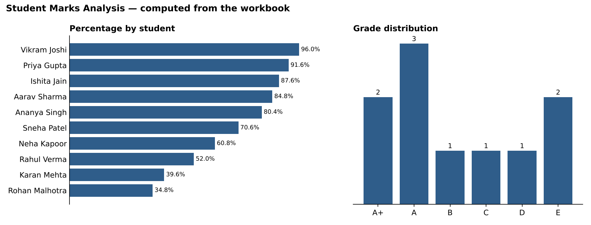

# 🎓 Project 1 — Student Marks Analysis

A gradebook that turns raw subject marks into totals, averages, percentages, letter grades and pass/fail results using core Excel formulas.

## Brief
> Create an Excel sheet with student names, subject-wise marks, total marks, percentage, grades, and pass/fail status using formulas like `SUM()`, `AVERAGE()` and `IF()`.
> — [project brief](../docs/Basic_to_Advanced_Excel_Projects_Brief.docx)

## What the workbook does
| Column | Formula / logic |
|---|---|
| Total Marks Obtained | `=SUM(B3:F3)` across 5 subjects (Maths, Science, English, Computer, Social Studies) |
| Total Marks | 500 (5 × 100) |
| Average Marks | `=AVERAGE(B3:F3)` |
| Percentage | `=G3/H3*100` |
| Grade | Nested `IF`: **A+** ≥ 90 · **A** ≥ 80 · **B** ≥ 70 · **C** ≥ 60 · **D** ≥ 40 · **E** below 40 |
| Pass / Fail | `=IF(AND(B3>=33, C3>=33, D3>=33, E3>=33, F3>=33),"Pass","Fail")` — a student must score **at least 33 in every subject** |

Extras: a **data bar** on percentage, a **colour scale** on subject marks, **text highlighting** for Pass/Fail, and a lookup row that pulls the top scorer's full record with an array formula.

## Results
- **10 students** · class average percentage **69.8%**
- **9 Pass, 1 Fail** — Rohan Malhotra fails (29 in Maths)
- Top scorer: **Vikram Joshi — 96%**
- Grade split: A+ 2 · A 3 · B 1 · C 1 · D 1 · E 2
- Interesting edge case: Karan Mehta scores 39.6% (grade **E**) but still **passes**, because the pass rule is per-subject (all ≥ 33) rather than based on overall percentage.

## Skills demonstrated
`SUM` · `AVERAGE` · nested `IF` · `AND` · conditional formatting (data bars, colour scales, text rules) · array formulas

## How to use
Open `Student_Marks_Analysis.xlsx`, edit any subject mark, and totals, grade and pass/fail update automatically. Add students by copying the formula row down.

---
[← Back to all projects](../README.md)
